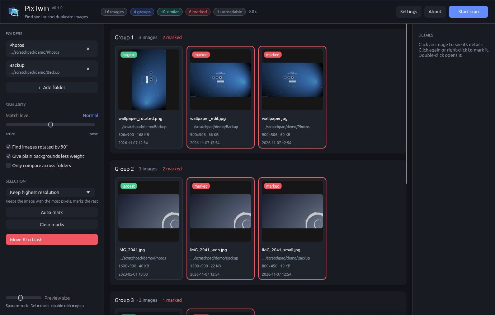

<p align="center">
  
</p>

<h1 align="center">PixTwin</h1>

<p align="center">
  Find similar and duplicate images – even when they were resized, recompressed,<br>
  slightly cropped, brightened or rotated by 90°.
</p>

<p align="center">
  
</p>

## Features

- **Visual matching**, not just byte comparison: finds resized, re-encoded, lightly edited and rotated copies.
- **Match level slider** from *strict* to *loose*, with advanced thresholds in Settings.
- **Fast**: images are decoded and compared in parallel; only images with a similar brightness are compared.
- **Clear results**: groups with thumbnails, path, resolution, file size and modification date.
- **Auto-mark rules**: keep highest resolution · keep largest file · mark longest paths · mark older files · mark newer files.
- **Safe cleanup**: marked files go to the system trash after a confirmation – nothing is deleted permanently.
- **Formats**: JPEG, PNG, GIF, BMP, TIFF, WebP, TGA, ICO, PNM, QOI.
- **Headless mode** for scripts: `pixtwin --cli`.

## Install

Download the archive for your system from the [Releases](../../releases) page and run `pixtwin` (`pixtwin.exe` on Windows).

Or build it yourself with Rust 1.95 or newer:

```bash
cargo install --path .
```

On Linux the build needs the usual windowing headers, e.g. on Debian/Ubuntu:

```bash
sudo apt install libxkbcommon-dev libxcb-render0-dev libxcb-shape0-dev libxcb-xfixes0-dev libwayland-dev libgl1-mesa-dev
```

## Usage

1. Add one or more folders (button or drag & drop).
2. Choose a match level and options, then press **Start scan**.
3. Click an image for details; click it again, right-click it or press <kbd>Space</kbd> to mark it.
4. Use **Auto-mark** with a rule, review the marks and press **Move to trash** (or <kbd>Del</kbd>).

Double-click opens an image in your default viewer.

### Command line

```text
pixtwin [FOLDER…]                 open the window, optionally with folders preselected
pixtwin --cli [OPTIONS] FOLDER…   scan without a window and print the groups

  --level 0..8   similarity: 0 = strict, 4 = normal (default), 8 = loose
  --rot          also find images rotated by 90°
  --no-bg        do not give plain backgrounds less weight
  --across       only compare images from different folders
```

## How it works

1. Every image is reduced to a **50×50 grid** with separate red, green and blue planes.
2. The contrast of the grid is stretched row by row and column by column, which makes the signature robust against brightness and contrast changes.
3. Images are sorted by their average brightness. Only neighbours with similar brightness and average colour are compared.
4. A **coarse test** on 25 sample points quickly rejects most pairs; a **fine test** on all 2500 points decides.
   Each point adds up the colour differences plus the brightness difference; large uniform backgrounds count only half.
5. Matches are merged into groups.

The matching approach is inspired by the freeware tool VisiPics. PixTwin is an independent implementation written from scratch in Rust.

## Development

```bash
cargo run --release      # start the app
cargo test               # unit tests
cargo clippy -- -D warnings
cargo fmt
```

| File | Purpose |
|---|---|
| `src/signature.rs` | 50×50 signature, contrast normalisation, average and background colour |
| `src/compare.rs` | distance, coarse/fine test, thresholds, grouping |
| `src/scan.rs` | background scan: find files, decode in parallel, compare, thumbnails |
| `src/app.rs` | user interface (egui / eframe) |
| `assets/` | logo (SVG, PNG, ICO) and Linux desktop entry |

### Releasing

1. Update the version in `Cargo.toml` and add a section to `CHANGELOG.md`.
2. Commit, then tag and push: `git tag v0.1.0 && git push origin main --tags`.
3. The *Release* workflow builds Linux, Windows and macOS (Intel and Apple Silicon) archives and publishes them as a GitHub release.

## License

[MIT](LICENSE)
